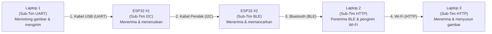
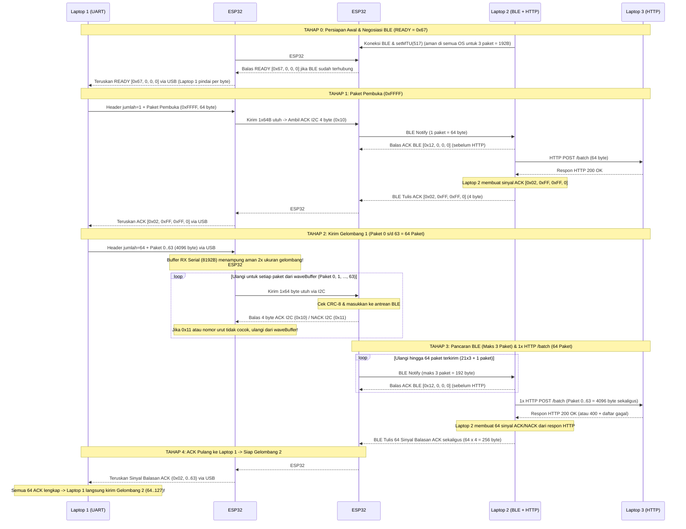

# Panduan Kerja & Standar Pengiriman Data Proyek (Rencana A)

Dokumen ini adalah **panduan bersama** untuk seluruh tim agar setiap kelompok tahu **bagian mana yang harus dikerjakan**, **bentuk data yang harus dikirim**, **urutan alur pengirimannya**, dan **format sinyal balasan (ACK/NACK)** sehingga pekerjaan semua tim bisa langsung nyambung saat digabungkan.

---

## 1. Gambaran Besar Alur Pengiriman

Kita ingin mengirim sebuah **gambar** dari **Laptop 1** ke **Laptop 3**. Gambar dipotong-potong menjadi ribuan **"amplop paket" kecil** (masing-masing **64 byte**), lalu dikirim estafet per gelombang (**64 paket = `4096 byte`** pada gelombang normal) melewati 4 jalur:

---

## 2. Pembagian Tugas Tiap Sub-Tim

| Sub-Tim | Alat yang Dipegang | Input yang Diterima | Output yang Dikirim | Tugas Utama |
| :--- | :--- | :--- | :--- | :--- |
| **1. Sub-Tim UART** | **Laptop 1** | File gambar (`.jpg`/`.png`, < 2 MB) + Sinyal Balasan 4 byte (`READY`/`ACK`/`NACK`) dari ESP32 #1 | Header 1 byte jumlah paket (`1..64`) + potongan paket 64 byte ke ESP32 #1 lewat kabel USB (`500000` baud) | Memotong gambar jadi paket 64 byte, mengirim per gelombang (**64 paket** pada gelombang normal), menunggu seluruh `ACK` gelombang tersebut, dan mengirim ulang jika ada yang gagal/`NACK`. |
| **2. Sub-Tim I2C** | **ESP32 #1** | Header + gelombang paket (`maks 4096 byte`) dari USB + Sinyal Balasan dari ESP32 #2 | Paket utuh ke ESP32 #2 lewat kabel I2C (`1×64 byte`) + teruskan Sinyal Balasan (`READY`/`ACK`/`NACK`) ke Laptop 1 | Memperbesar buffer RX Serial (`8192 byte` = 2× ukuran gelombang) dan buffer I2C (`256 byte`), menampung kiriman USB ke `waveBuffer[4096]`, mengirim paket **utuh 64 byte sekali jalan** via I2C ke ESP32 #2, lalu mengambil antrean ACK dari ESP32 #2. |
| **3. Sub-Tim BLE** | **ESP32 #2** | Paket `1×64 byte` dari ESP32 #1 lewat I2C + Sinyal Balasan 4 byte (`ACK BLE 0x12` & `ACK/NACK Akhir 0x02/0x03`) dari Laptop 2 lewat BLE | Pancaran Bluetooth (maks **3 paket = 192 byte** sekali kirim) ke Laptop 2 + Sinyal Balasan (`READY`/`ACK`/`NACK`) ke ESP32 #1 lewat I2C | Memperbesar buffer I2C (`256 byte`), bebas memakai library BLE apa saja (`BLEDevice.h` bawaan atau lainnya), memanggil `setMTU(517)` di awal, mengecek CRC-8 paket I2C, mengirim maks **3 paket** per pancaran BLE dan menunggu **`ACK BLE (0x12)`** dari Laptop 2 sebelum mengirim pancaran berikutnya, serta menaruh `ACK/NACK Akhir` ke antrean I2C. |
| **4. Sub-Tim HTTP** | **Laptop 2 & Laptop 3** | Pancaran Bluetooth (maks 3 paket = 192 byte per pancaran) dari ESP32 #2 di Laptop 2 | Sinyal `ACK BLE (0x12)` & `ACK/NACK Akhir (0x02/0x03)` dari Laptop 2 ke ESP32 #2 lewat BLE + Kiriman 1 gelombang (`HTTP POST /batch`, maks **64 paket = 4096 byte**) dari Laptop 2 ke Laptop 3 + File gambar utuh di Laptop 3 | **Di Laptop 2:** Menerima pancaran BLE dan langsung membalas `ACK BLE (0x12)`, mengumpulkan paket hingga genap 1 gelombang (64 paket) lalu mengirim **1× `HTTP POST /batch`** ke Laptop 3, kemudian membaca respon HTTP (`200 OK` / `400 Error`) untuk **membuat** sinyal ACK/NACK 4 byte (`0x02`/`0x03`) ke ESP32 #2 via BLE. **Di Laptop 3:** Menerima `HTTP POST /batch`, mengecek CRC-8 tiap paket, menyimpan yang valid, dan menyusun kembali file gambar utuh. |

> [!IMPORTANT]
> **Catatan Pemasangan Kabel I2C (ESP32 #1 ↔ ESP32 #2):**
> Kedua ESP32 sama-sama bekerja di tegangan **3.3 Volt**, sehingga **tidak perlu Level Shifter** lagi. Cukup sambungkan pin `SDA ↔ SDA`, `SCL ↔ SCL`, dan `GND ↔ GND` dengan kabel pendek (disarankan pasang resistor *pull-up* `2.2 kΩ – 4.7 kΩ` ke `3.3V` pada jalur SDA dan SCL agar komunikasi `400000 Hz` tetap stabil).

---

## 3. Aturan "Amplop Paket" Data Gambar (64 Byte — Wajib Sama di Semua Tim)

Semua tim memakai ukuran amplop yang sama persis, yaitu **64 byte** per paket. Dari awal sampai akhir, **satu-satunya nomor identitas paket adalah Nomor Urut di amplop 64 byte ini**:

| Bagian Amplop | Ukuran | Isi / Gunanya |
| :--- | :---: | :--- |
| **Nomor Urut** | 2 byte | Penanda urutan potongan gambar (`0x0000` s/d `0xFFFE` atau `0` s/d `65534`). Khusus nomor **`0xFFFF`** (`65535`) adalah **Paket Pembuka** (lihat rincian di bawah). |
| **Panjang Isi** | 1 byte | Memberi tahu berapa banyak isi gambar di dalam paket ini (`1` sampai `60` byte). |
| **Isi Potongan Gambar** | 60 byte | Potongan data gambar yang sebenarnya (atau info file jika ini Paket Pembuka `0xFFFF`). |
| **Kode Cek Rusak (CRC)** | 1 byte | Angka hasil hitungan otomatis untuk mengecek apakah paket ini rusak/berubah di tengah jalan. |

### Spesifik Isi Paket Pembuka (`Nomor Urut = 0xFFFF`)
Karena nomor urut berukuran 2 byte, nilai maksimalnya adalah `0xFFFF` (`65535`). Nilai ini dipesan khusus sebagai **Paket Pembuka**. Isi bagian **60 byte payload** (`byte 3..62` pada amplop 64 byte) adalah:
- **Byte isi `0..3` (4 byte, yaitu byte `3..6` amplop):** Ukuran total file gambar dalam byte (contoh: `136097` byte).
- **Byte isi `4..59` (maks 56 byte, yaitu byte `7..62` amplop):** Nama file gambar (contoh: `"img.jpeg"`).

### Mekanisme Pembuatan & Pengecekan Kode Cek Rusak (`CRC-8`)
1. **Dibuat di Laptop 1 (Pengirim):** Menghitung nilai `CRC-8 Maxim` dari byte ke-`0` sampai `62`, lalu menaruh hasilnya di byte ke-`63`.
2. **Dicek di Titik 1 — ESP32 #2 (Tepat setelah menerima `1×64 byte` dari I2C):**
   - Jika cocok: masukkan ke antrean BLE, balas `ACK I2C (0x10)`.
   - Jika tidak cocok: buang paket dan balas `NACK I2C (0x11, kode error 1)` agar ESP32 #1 mengirim ulang saat itu juga.
3. **Dicek di Titik 2 — Laptop 3 (Tepat setelah menerima `HTTP POST /batch`):**
   - Laptop 3 memeriksa setiap paket di dalam batch: paket yang valid **tetap disimpan**, sedangkan paket yang rusak dicatat nomor urutnya.
   - Jika semua valid: Laptop 3 membalas **`200 OK`** (`{"status": "batch_ok"}`).
   - Jika ada yang rusak: Laptop 3 membalas **`400 Error`** berisi daftar nomor urut yang gagal (`{"status": "batch_error", "failed": [5]}`). Laptop 2 membaca respon ini lalu membuatkan `NACK (0x03)` untuk nomor `5` saja dan `ACK (0x02)` untuk paket lainnya yang valid.

*(Catatan: **ESP32 #1** dan **Laptop 2** tidak perlu menghitung CRC-8 agar kerjanya tetap ringan dan cepat).*

---

## 4. Alur Lengkap Pengiriman (Dari Awal Sampai Siap Gelombang ke-2)

### Penjelasan Rinci Tiap Tahap:

1. **Tahap 0 — Persiapan Awal & Pengaturan MTU BLE (`0x67` = `READY`):**
   - Laptop 3 menyalakan program penerima HTTP, Laptop 2 menyalakan program jembatan dan tersambung ke Bluetooth ESP32 #2.
   - **Pengaturan MTU BLE:** Bawaan BLE hanya mengizinkan maksimal `20 byte` sekali kirim (tidak cukup untuk 1 paket `64 byte`). Karena itu ESP32 #2 memanggil `setMTU(517)` di awal agar koneksi BLE sanggup menampung ukuran pancaran yang disepakati bersama: **maksimal 3 paket (`3 × 64 = 192 byte`)** sekali kirim (ukuran ini aman di Windows, Linux, maupun macOS).
   - Begitu BLE siap, ESP32 #1 menanyakan status ke ESP32 #2 lewat perintah **`0x02` (`CHECK_READY`)** via I2C; jika BLE sudah tersambung, ESP32 #2 membalas `READY` (`0x67`) untuk diteruskan ke Laptop 1. Laptop 1 mereset ESP32 #1 (`RTS`) saat membuka port USB dan memindai `[0x67, 0, 0, 0]` per byte agar tidak tergeser teks boot ROM ESP32 (`115200` baud).

2. **Tahap 1 — Paket Pembuka (`0xFFFF`):**
   - Laptop 1 mengirim `header jumlah=1` + Paket Pembuka `0xFFFF` (`64 byte`) berisi ukuran total dan nama file, lalu menunggu `ACK (0x02)` untuk `0xFFFF` pulang sebelum mulai mengirim potongan gambar.

3. **Tahap 2 — Mengirim Gelombang 1 (`Header Jumlah` + `waveBuffer[4096]` + `1×64 Byte` I2C):**
   - **Di Laptop 1 → ESP32 #1 (UART tanpa `CTS`):**
     - Karena ESP32 #1 menggunakan `Serial.setRxBufferSize(8192)` (**8192 byte**, yaitu **2× ukuran 1 gelombang `4096 byte`**) dan Laptop 1 selalu menunggu seluruh ACK gelombang sebelumnya selesai sebelum mengirim gelombang baru, maka **`CTS` tidak diperlukan lagi**. Seluruh kiriman 1 gelombang langsung tertampung aman di buffer RX Serial ESP32 #1.
     - Laptop 1 mengirim **1 byte header jumlah paket (`1..64`)** diikuti paket-paket gambarnya. Pada gelombang normal jumlahnya selalu **64 paket (`4096 byte`)**; header 1 byte ini dipakai agar ESP32 #1 juga langsung tahu ukuran pasti saat **gelombang terakhir** (misal sisa 29 paket) atau saat **kirim ulang (*retry*)** (misal hanya 1–2 paket) tanpa perlu menunggu timeout.
     - ESP32 #1 membaca `N × 64 byte` tersebut ke dalam `waveBuffer[4096]` sebelum mulai mengirim ke I2C.
   - **Di ESP32 #1 → ESP32 #2 (I2C — `1×64 Byte` Utuh):**
     - Kedua ESP32 memanggil `Wire.setBufferSize(256)` sebelum `Wire.begin(...)` agar buffer I2C cukup menampung paket `64 byte` utuh sekaligus (**tidak perlu dipecah `2×32 byte`**).
     - ESP32 #1 mengirim tiap paket `64 byte` dari `waveBuffer` dalam **1× transaksi I2C**, memberi jeda singkat **`500 µs` (`0,5 ms`)** agar ESP32 #2 sempat menyiapkan balasan, lalu membaca **4 byte ACK I2C (`0x10` / `0x11`)** dan **wajib mencocokkan nomor urutnya** dengan paket yang baru dikirim. Jika `0x11` atau nomor urut salah, ESP32 #1 langsung mengirim ulang paket itu dari `waveBuffer`.

4. **Tahap 3 — Pancaran Bluetooth (`Maks 3 Paket`) + `ACK BLE (0x12)` & 1× HTTP `/batch`:**
   - **Di ESP32 #2 → Laptop 2 (BLE):**
     - ESP32 #2 mengirim maksimal **3 paket (`192 byte`)** dalam satu pancaran BLE (jadi 64 paket dikirim dalam 22 pancaran: `21 × 3 + 1` paket).
     - Setelah mengirim satu pancaran, ESP32 #2 **menunggu sinyal `ACK BLE (0x12)`** dari Laptop 2 sebelum mengirim pancaran berikutnya. Dengan aturan ini, antrean Bluetooth di ESP32 #2 tidak akan pernah penuh/membuang paket, dan tim BLE **bebas memakai library apa saja** (termasuk `BLEDevice.h` bawaan ESP32).
     - **Di Laptop 2:** Begitu menerima satu pancaran BLE, Laptop 2 **langsung membalas `ACK BLE (0x12)`** ke ESP32 #2 *sebelum* mengirim ke HTTP, agar ESP32 #2 bisa langsung lanjut mengirim pancaran berikutnya.
   - **Di Laptop 2 → Laptop 3 (HTTP):**
     - Laptop 2 mengumpulkan paket gelombang hingga genap **64 paket** (atau setelah batas tunggu **`150 ms`** jika itu gelombang terakhir atau kiriman ulang yang kurang dari 64 paket), lalu mengirimkannya sekaligus dalam **1 kali `HTTP POST /batch`** ke Laptop 3.
     - Begitu Laptop 3 memeriksa CRC-8 seluruh paket dan membalas **`200 OK`** (atau **`400 Error`** jika ada yang rusak), **Laptop 2 membuatkan Sinyal Balasan 4 byte (`0x02` / `0x03`)** untuk setiap paket di batch tadi dan mengirimkannya balik ke ESP32 #2 lewat Bluetooth menggunakan `Write Without Response` (`response=False`), dipecah sesuai batas write (`20 byte` jika MTU terbaca `23`) dengan jeda **`15 ms`** antar potongan agar Bluedroid ESP32 #2 tidak kewalahan/putus, memakai `Lock` terhadap `ACK BLE (0x12)`, serta *auto-reconnect* jika BLE sempat terputus.

5. **Tahap 4 — ACK Sampai di Laptop 1 & Siap Kirim Gelombang ke-2:**
   - Setelah ke-64 paket (atau sisa paket gelombang akhir/retry) selesai dikirim ke ESP32 #2, ESP32 #1 mengambil antrean sinyal balasan dari ESP32 #2 lewat I2C (mengirim **1 byte perintah `0x01`**, jeda `500 µs`, lalu membaca **`64 byte` = maks 16 sinyal** per pengambilan, diulang hingga antrean kosong) dan meneruskannya lewat USB ke Laptop 1.
   - **Di Laptop 1:**
     - Jika ada paket yang mendapat `NACK (0x03)` (atau belum mendapat ACK dalam batas waktu **`15.000 ms`**), Laptop 1 mengirim ulang paket tersebut saja pada giliran berikutnya.
     - Begitu seluruh 64 paket (`0..63`) mendapat `ACK (0x02)`, Laptop 1 **langsung mengirim Gelombang 2 (`64..127`)** hingga seluruh gambar selesai.

---

## 5. Aturan Seragam "Sinyal Balasan" (Format 4 Byte)

Semua jalur (**UART, I2C, dan BLE**) memakai format **Sinyal Balasan tetap 4 byte**:

| Kotak ke- | Ukuran | Isinya | Pilihan Nilai (Hexadesimal) |
| :--- | :---: | :--- | :--- |
| **Kotak 1** | 1 byte | **Jenis Pesan** | `0x67` = **`READY`** (ESP32 #2 & Bluetooth siap) `0x02` = **`ACK` Akhir** (paket diterima valid oleh Laptop 3, dibuat oleh Laptop 2) `0x03` = **`NACK` Akhir** (gagal di BLE/HTTP, dibuat oleh Laptop 2 untuk kirim ulang) `0x10` = **`ACK` I2C** (paket utuh masuk ESP32 #2 & siap lanjut) `0x11` = **`NACK` I2C** (rusak di kabel I2C, ulangi di tempat) `0x12` = **`ACK` BLE** (pancaran BLE diterima Laptop 2, ESP32 #2 siap kirim pancaran berikutnya) |
| **Kotak 2 & 3** | 2 byte | **Nomor Urut Paket** | Angka `0x0000` sampai `0xFFFF` (diisi `0x0000` untuk `READY` dan `ACK BLE`) |
| **Kotak 4** | 1 byte | **Kode Penyebab Error** | `0` = Aman/Sukses, `1` = Data rusak (CRC salah), `2` = Gagal kirim BLE/HTTP |

---

## 6. Rincian ACK/NACK di Setiap Jalur Komunikasi

### A. Jalur 1 — HTTP (Laptop 3 ↔ Laptop 2)
- **Kapan terjadi:** Setiap kali Laptop 2 selesai mengumpulkan paket 1 gelombang (`64 paket = 4096 byte`, atau sisa paket gelombang terakhir/retry) dari Bluetooth dan mengirimkannya dalam **1 kali `POST /batch`** ke Laptop 3.
- **Bentuk respon HTTP dari Laptop 3:**
  - Semua paket di batch valid → **`200 OK`** (`{"status": "batch_ok"}`).
  - Ada sebagian paket yang rusak → Laptop 3 tetap menyimpan paket yang valid, lalu membalas **`400 Error`** berisi daftar nomor urut yang rusak (`{"status": "batch_error", "failed": [5]}`).
- **Apa yang dilakukan Laptop 2:** Membaca respon HTTP dari Laptop 3, lalu **Laptop 2 membuatkan Sinyal Balasan 4 byte** (`0x02` = ACK untuk yang lolos, `0x03` = NACK untuk yang ada di `failed`) untuk setiap paket di batch tadi, menjejerkannya jadi satu pesan (misal 64 paket = `256 byte`), dan mengirimkannya ke ESP32 #2 lewat Bluetooth.

### B. Jalur 2 — BLE / Bluetooth (Laptop 2 ↔ ESP32 #2)
Di jalur BLE, ada **2 jenis sinyal balasan** yang dikirim Laptop 2 ke ESP32 #2 (`RX_CHAR`):
1. **ACK Khusus BLE (`0x12` — 4 byte):**
   - Dikirim oleh Laptop 2 **segera setelah menerima 1 pancaran BLE** (maks 3 paket = 192 byte) *sebelum* mengirim HTTP ke Laptop 3.
   - Menjamin ESP32 #2 tidak pernah membanjiri antrean Bluetooth sehingga aman memakai library apa saja.
2. **Jejeran ACK/NACK Akhir (`0x02` / `0x03` — kelipatan 4 byte):**
   - Dikirim oleh Laptop 2 setelah mendapat respon HTTP dari Laptop 3.
   - ESP32 #2 memisahkannya per 4 byte dan menaruhnya ke antrean untuk diambil ESP32 #1 lewat I2C.

### C. Jalur 3 — I2C (ESP32 #2 ↔ ESP32 #1)
Pada jalur I2C, ESP32 #2 harus menyiapkan data balasan **sebelum** ESP32 #1 membacanya (ESP32 #1 memberi jeda **`500 µs`** antara kirim perintah/paket dan membaca balasan). Setiap pengambilan balasan didahului penanda yang jelas:
1. **Cek `READY` (`0x02` — 4 byte):**
   - Saat baru menyala, ESP32 #1 mengirim **1 byte perintah `0x02`** ke ESP32 #2, lalu membaca `4 byte` (`0x67` jika BLE sudah tersambung, atau `0x00` jika belum).
2. **ACK/NACK Khusus I2C (`0x10` / `0x11` — 4 byte):**
   - Begitu 1 paket utuh (`64 byte`) diterima ESP32 #2, ESP32 #2 langsung menyiapkan 4 byte status paket tersebut (`0x10` atau `0x11`). ESP32 #1 membacanya (`4 byte`) dan **mencocokkan nomor urutnya**.
3. **Antrean ACK Akhir (`0x02` / `0x03`) — maks 16 sinyal (`64 byte`):**
   - Sebelum membaca antrean `64 byte`, ESP32 #1 mengirim **1 byte perintah (`0x01`)** ke ESP32 #2 agar ESP32 #2 menyiapkan hingga 16 sinyal balasan dari antrean (slot kosong diisi `[0x00, 0x00, 0x00, 0x00]`), baru kemudian ESP32 #1 membaca `64 byte` tersebut (bisa dilakukan berulang hingga seluruh 64 ACK gelombang tersebut selesai diambil).

### D. Jalur 4 — UART / Kabel USB (ESP32 #1 ↔ Laptop 1)
- **Kirim Data (Laptop 1 → ESP32 #1):** Laptop 1 mengirim `1 byte jumlah paket (1..64)` diikuti paket `64 byte` langsung ke USB tanpa menunggu `CTS`, karena buffer RX Serial ESP32 #1 (`8192 byte`) menampung 2× ukuran gelombang penuh.
- **Penerusan Balasan (ESP32 #1 → Laptop 1):** ESP32 #1 meneruskan Sinyal Balasan 4 byte (`0x67`, `0x02`, `0x03`) dari ESP32 #2 apa adanya ke Laptop 1 lewat kabel USB.
- **Laptop 1** menunggu `READY` (`0x67`) di awal, lalu menunggu seluruh 64 paket di Gelombang 1 mendapat `0x02` (`ACK`) sebelum langsung mengirim Gelombang 2 (`64..127`).

---

## 7. Cara Tiap Tim Mengetes Bagiannya Sendiri (Sebelum Digabung)

- **Sub-Tim UART:** Uji kirim [img.jpg](file:///home/maaku/responsi_pjk/img.jpg) dalam format `1 byte jumlah + paket 64 byte` (maks 64 paket per gelombang), dan pastikan timeout (`15.000 ms`) & retry bekerja saat sebagian ACK dihilangkan.
- **Sub-Tim I2C:** Uji ESP32 #1 menerima `1 + 4096 byte` via Serial (`setRxBufferSize(8192)`) ke `waveBuffer[4096]`, mengirim `1×64 byte` utuh ke ESP32 #2 dengan baca `4 byte` (`0x10`), serta kirim perintah `0x01` sebelum baca `64 byte` antrean ACK.
- **Sub-Tim BLE:** Uji ESP32 #2 memancarkan maksimal 3 paket (`192 byte`) per kirim lewat BLE, menerima balik `ACK BLE (0x12)` sebelum lanjut ke pancaran berikutnya, serta menerima jejeran `ACK Akhir (0x02/0x03)` dan menaruhnya ke antrean I2C.
- **Sub-Tim HTTP:** Uji program di **Laptop 2** (menerima data BLE, membalas `ACK BLE 0x12`, mengumpulkan 64 paket lalu mengirim `POST /batch` ke Laptop 3, dan membuat sinyal 4 byte `0x02`/`0x03` dari respon HTTP) serta program di **Laptop 3** (menerima `POST /batch` yang salah satu paketnya sengaja dirusak CRC-nya, memastikan paket yang benar tetap tersimpan, `failed` berisi nomor paket yang rusak saja, dan gambar tersusun utuh).

---

## 8. Catatan Angka Wajib Sama (Untuk Dipakai Saat Menulis Kode)

- **Kecepatan & Buffer Kabel USB (UART):** `500000` baud; ESP32 #1 wajib memanggil `Serial.setRxBufferSize(8192)` sebelum `Serial.begin(500000)`
- **Ukuran Gelombang & Buffer RAM di ESP32 #1:** Maksimal **64 paket (`4096 byte`)** per gelombang (`uint8_t waveBuffer[4096]`)
- **Batas Waktu (*Timeout*):** Timeout tunggu ACK Akhir di Laptop 1 **`15.000 ms`** per gelombang; batas tunggu gelombang tidak penuh di Laptop 2 **`150 ms`**
- **Alamat, Kecepatan, & Ukuran Transaksi I2C:** Alamat ESP32 #2 `0x42`, kecepatan `400000` Hz; kedua ESP32 wajib memanggil `Wire.setBufferSize(256)` sebelum `Wire.begin(...)`; kirim **`1×64 byte` utuh** per paket; beri jeda **`500 µs`** sebelum `Wire.requestFrom(...)`; kirim `0x02` lalu baca `4 byte` untuk cek `READY`; baca `4 byte` untuk ACK I2C; kirim `0x01` lalu baca `64 byte` (maks 16 sinyal) untuk antrean ACK Akhir
- **Pengaturan BLE ESP32 #2 & Laptop 2:** Wajib memanggil `setMTU(517)` di awal; batas sekali pancaran BLE adalah **maksimal 3 paket (`192 byte`)** dan wajib menunggu `ACK BLE (0x12)` sebelum pancaran berikutnya; Laptop 2 menulis balik ACK dengan `response=False` berjeda **`15 ms`** antar potongan (`20 byte` jika MTU terbaca `23`), memakai `Lock`, serta *auto-reconnect*; bebas memilih library BLE, nama perangkat, serta UUID layanan (selama **Sub-Tim BLE** di ESP32 #2 dan **Sub-Tim HTTP** di Laptop 2 menyepakati nama & UUID yang sama)
- **Alamat Penerima Wi-Fi (HTTP):** `http://<IP_LAPTOP_3>:5000/batch`

---

## 9. Glosarium Istilah Teknis

| Istilah | Arti Sederhana |
| :--- | :--- |
| **`Serial.setRxBufferSize(8192)`** | Perintah di ESP32 #1 untuk memperbesar buffer terima USB dari `256 byte` menjadi `8.192 byte` (2× ukuran 1 gelombang `4.096 byte`), sehingga kiriman dari Laptop 1 tidak pernah meluap dan tidak perlu sinyal `CTS`. |
| **`waveBuffer[4096]`** | Variabel array di memori RAM ESP32 #1 berukuran `4.096 byte` untuk menampung sementara 1 gelombang penuh (`64 paket × 64 byte`) yang baru masuk dari kabel USB, sebelum dikirim per paket lewat I2C. |
| **`Wire.setBufferSize(256)`** | Perintah di kedua ESP32 untuk memperbesar buffer I2C menjadi `256 byte`, sehingga 1 paket `64 byte` bisa dikirim utuh dalam 1× transaksi I2C (dan antrean ACK bisa diambil hingga 16 sinyal = `64 byte` sekaligus). |
| **Resistor *Pull-Up* I2C** | Resistor (`2.2 kΩ – 4.7 kΩ`) yang dipasang dari jalur `SDA` dan `SCL` ke `3.3V` agar sinyal I2C tetap tajam pada kecepatan `400000 Hz`. |
| **`ATT_MTU` / `MTU`** | Batas maksimal ukuran data (dalam byte) yang bisa dikirim dalam sekali pancaran Bluetooth. Bawaannya hanya `23 byte` (`20 byte` isi), maka ESP32 #2 memanggil `setMTU(517)` agar bisa mengirim `3 paket = 192 byte` sekaligus. |
| **`CRC-8` (*Cyclic Redundancy Check*)** | Angka cek 1 byte yang dihitung dari isi paket untuk mendeteksi apakah ada data yang rusak atau berubah di tengah jalan. |
| **`ACK` / `NACK`** | `ACK` (*Acknowledge*) = tanda paket diterima dengan benar; `NACK` (*Negative Acknowledge*) = tanda paket rusak/gagal dan harus dikirim ulang. |
