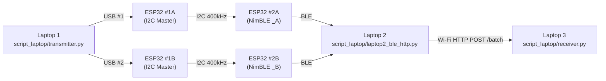

# Proyek Pengiriman Gambar Estafet (UART → I2C → BLE → HTTP)

Proyek ini mengirim file gambar (`.jpg`/`.jpeg`/`.png`) dari **Laptop 1** ke **Laptop 3** secara estafet melewati 4 protokol komunikasi berbeda (**UART → I2C → BLE → HTTP**) dengan dukungan **2 jalur paralel (`dual-lane`, 4× ESP32)**, pengecekan integritas `CRC-8 Maxim`, dan kirim ulang (*retry*) otomatis.

Standar protokol lengkap tersedia di [AGENTS.md](AGENTS.md).

---

## 1. Struktur Folder

```text
responsi_pjk/
├── script_laptop/                 # Program Python untuk Laptop 1, Laptop 2, dan Laptop 3
│   ├── transmitter.py             # Laptop 1: potong gambar 64B, kirim UART (1 atau 2 port)
│   ├── laptop2_ble_http.py        # Laptop 2: jembatan BLE (NimBLE) -> HTTP POST /batch
│   ├── receiver.py                # Laptop 3: server HTTP, validasi CRC-8, susun gambar + preview
│   └── README.md                  # Dokumentasi rinci tiap script Python
├── script_esp32/                  # Sketch Arduino untuk ESP32 #1 dan ESP32 #2
│   ├── esp32_i2c_master/          # ESP32 #1A & #1B: UART RX -> I2C Master 1x64B
│   ├── esp32_ble_slave/           # ESP32 #2A & #2B: I2C Slave -> NimBLE-Arduino
│   └── README.md                  # Dokumentasi rinci tiap sketch ESP32
├── samples/                       # Gambar sampel untuk pengujian
│   ├── img.jpg                    # ~8.5 KB
│   ├── img.jpeg                   # ~136 KB
│   └── image.jpeg                 # ~908 KB
├── received_images/               # Folder hasil gambar yang diterima Laptop 3
├── requirements.txt               # Daftar library Python (pyserial, bleak, flask, opencv-python, numpy)
├── AGENTS.md                      # Panduan standar protokol tim
└── README.md                      # Dokumentasi utama proyek
```

---

## 2. Arsitektur 2 Jalur Paralel (*Dual-Lane*)



---

## 3. Cara Menjalankan

### Persiapan
1. **Python (`.venv`):**
   ```bash
   python3 -m venv .venv
   .venv/bin/pip install -r requirements.txt
   ```
2. **ESP32 (Arduino IDE):**
   - Install library **`NimBLE-Arduino`** (v2.x oleh *h2zero*) lewat *Library Manager*.
   - Upload `script_esp32/esp32_i2c_master/esp32_i2c_master.ino` ke **ESP32 #1A** dan **ESP32 #1B**.
   - Upload `script_esp32/esp32_ble_slave/esp32_ble_slave.ino` ke **ESP32 #2A** dan **ESP32 #2B** dengan `DEVICE_NAME` berbeda (`"ESP32_IMG_BRIDGE_A"` dan `"ESP32_IMG_BRIDGE_B"`).
   - Pasang I2C (`GPIO 21 ↔ 21`, `GPIO 22 ↔ 22`, `GND ↔ GND`, disarankan pull-up `2.2–4.7 kΩ` ke `3.3V`) antara `#1A ↔ #2A` dan `#1B ↔ #2B`.

### Menjalankan Program
1. **Laptop 3 (Receiver + Live Preview):**
   ```bash
   .venv/bin/python script_laptop/receiver.py
   ```
2. **Laptop 2 (Bridge BLE → HTTP):**
   - Testing 1 laptop:
     ```bash
     .venv/bin/python script_laptop/laptop2_ble_http.py
     ```
   - 3 Laptop terpisah (ganti `<IP_LAPTOP_3>`):
     ```bash
     .venv/bin/python script_laptop/laptop2_ble_http.py --url http://<IP_LAPTOP_3>:5000/batch
     ```
3. **Laptop 1 (Transmitter):**
   - 2 jalur paralel:
     ```bash
     .venv/bin/python script_laptop/transmitter.py samples/image.jpeg --ports /dev/ttyUSB0 /dev/ttyUSB1
     ```
   - 1 jalur saja:
     ```bash
     .venv/bin/python script_laptop/transmitter.py samples/img.jpeg --ports /dev/ttyUSB1
     ```
