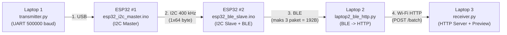

# Proyek Pengiriman Gambar Estafet (UART → I2C → BLE → HTTP)

Proyek ini mengirim file gambar (`.jpg`/`.jpeg`/`.png`) dari **Laptop 1** ke **Laptop 3** secara estafet melewati 4 protokol komunikasi berbeda menggunakan **2× ESP32**, dengan pengecekan integritas data (`CRC-8 Maxim`) dan mekanisme kirim ulang (*retry*) otomatis.

Standar protokol lengkap antar sub-tim tersedia di [AGENTS.md](AGENTS.md).

---

## 1. Arsitektur Sistem



---

## 2. Struktur File & Penjelasan Rinci Tiap Program

### Program Utama (5 Komponen)

#### 1. `transmitter.py` — Pengirim Gambar (Laptop 1 / Sub-Tim UART)
- **Tugas:** Memotong file gambar menjadi paket **64 byte**, mengirimkannya per gelombang (**64 paket = 4096 byte**) lewat USB Serial (`500000` baud), dan mengirim ulang paket yang gagal.
- **Cara kerja:**
  1. Saat membuka port serial, program mengirim pulsa `RTS` untuk me-reset **ESP32 #1**, lalu memindai sinyal `READY` (`[0x67, 0x00, 0x00, 0x00]`) per byte agar tidak tergeser oleh teks boot ROM ESP32.
  2. Membentuk Paket Pembuka (`0xFFFF`) berisi ukuran total file (`4 byte`) dan nama file (`maks 56 byte`), lalu mengirimkannya dengan `header = 1`.
  3. Memecah file gambar menjadi potongan `60 byte` per paket dan menambahkan `CRC-8 Maxim` di byte ke-63.
  4. Setiap gelombang mengirim `1 byte header jumlah (1..64)` diikuti `N × 64 byte` paket, lalu menunggu sinyal `ACK (0x02)` / `NACK (0x03)` dengan batas waktu **`15.0` detik**. Paket yang `NACK` atau timeout otomatis dikirim ulang pada putaran berikutnya.

#### 2. `esp32_i2c_master/esp32_i2c_master.ino` — Jembatan UART → I2C (ESP32 #1 / Sub-Tim I2C)
- **Tugas:** Menerima gelombang paket dari USB Laptop 1 ke RAM, meneruskannya satu per satu (`1×64 byte`) ke **ESP32 #2** via I2C (`400000 Hz`), dan mengambil antrean ACK pulang ke Laptop 1.
- **Konfigurasi penting:**
  - `Serial.setRxBufferSize(8192)` (2× ukuran gelombang `4096 byte`) sebelum `Serial.begin(500000)` agar kiriman USB tidak meluap.
  - `Wire.setBufferSize(256)` sebelum `Wire.begin(21, 22, 400000)` agar paket `64 byte` bisa dikirim utuh sekali jalan (tanpa dipecah `2×32 byte`).
- **Cara kerja:**
  1. Saat `setup()`, mengirim perintah I2C `0x02` (`CMD_CHECK_READY`) setiap `100 ms` sampai **ESP32 #2** membalas `0x67` (`READY`), lalu meneruskannya ke Laptop 1.
  2. Membaca `1 byte count` lalu `count × 64 byte` ke `waveBuffer[4096]`.
  3. Mengirim tiap paket `64 byte` ke alamat I2C `0x42`, memberi jeda **`500 µs`**, lalu membaca `4 byte` `ACK I2C (0x10)` dan mencocokkan nomor urutnya (mengulang langsung dari `waveBuffer` jika gagal/`0x11`).
  4. Setelah seluruh paket gelombang masuk ke ESP32 #2, mengirim perintah `0x01` + jeda `500 µs` + membaca `64 byte` (maks 16 sinyal ACK Akhir) secara berkala dan meneruskan sinyal valid ke Laptop 1.

#### 3. `esp32_ble_slave/esp32_ble_slave.ino` — Jembatan I2C → BLE (ESP32 #2 / Sub-Tim BLE)
- **Tugas:** Menerima paket `64 byte` via I2C (`0x42`), memvalidasi `CRC-8`, memancarkannya lewat BLE ke Laptop 2, dan menyimpan antrean `ACK/NACK Akhir` untuk diambil ESP32 #1.
- **Konfigurasi penting:**
  - `Wire.setBufferSize(256)` sebelum `Wire.begin(0x42, 21, 22, 400000)`.
  - `BLEDevice::init("ESP32_IMG_BRIDGE")` dan `BLEDevice::setMTU(517)`.
  - Antrean internal: `bleQueue` (kapasitas `128` paket) dan `ackQueue` (kapasitas `256` sinyal 4 byte).
- **Cara kerja:**
  1. `onI2CReceive(1)`: jika menerima `0x01`, menyiapkan `64 byte` (`16 × 4 byte` dari `ackQueue`, slot kosong diisi `0x00`) via `Wire.slaveWrite`; jika menerima `0x02`, membalas `0x67` jika BLE sudah terhubung.
  2. `onI2CReceive(64)`: mengecek `CRC-8` byte `0..62` terhadap byte `63`. Jika cocok dan `bleQueue` muat, paket masuk antrean BLE dan membalas `ACK I2C (0x10)`; jika rusak, membalas `NACK I2C (0x11)`.
  3. `loop()`: mengambil maksimal **3 paket (`192 byte`)** dari `bleQueue`, mengirim lewat `notify()` (`TX_CHAR`), lalu menunggu sinyal **`ACK BLE (0x12)`** dari Laptop 2 sebelum mengirim pancaran berikutnya.
  4. `onWrite` (`RX_CHAR`): jika menerima `0x12`, menandai pancaran BLE selesai diterima; jika menerima kelipatan 4 byte (`0x02`/`0x03`), memasukkannya ke `ackQueue`.

#### 4. `laptop2_ble_http.py` — Jembatan BLE → HTTP (Laptop 2 / Sub-Tim HTTP)
- **Tugas:** Menerima pancaran BLE dari **ESP32 #2**, mengumpulkan paket satu gelombang, mengirimkannya lewat `HTTP POST /batch` ke **Laptop 3**, lalu membuat dan mengirim balik sinyal `ACK/NACK (0x02/0x03)` ke BLE.
- **Cara kerja:**
  1. Terhubung ke `ESP32_IMG_BRIDGE` menggunakan `bleak` (dengan *auto-reconnect* otomatis jika koneksi BLE terputus).
  2. Setiap menerima `notify` BLE, langsung membalas `ACK BLE [0x12, 0x00, 0x00, 0x00]` (memakai `asyncio.Lock` agar tidak bertabrakan dengan tulis ACK Akhir) sebelum memproses HTTP.
  3. Mengumpulkan paket ke batch hingga genap **64 paket** atau melewati jeda **`150 ms`** (`BATCH_WAIT_SEC = 0.15`), lalu mengirim **1× `HTTP POST /batch`**.
  4. Membaca respon HTTP (`200 OK` atau `400 Error` berisi daftar `failed`), membentuk sinyal 4 byte (`0x02` untuk paket valid, `0x03` untuk yang ada di `failed`), dan mengirimkannya balik ke `RX_CHAR` secara bertahap dengan jeda **`15 ms`** per potongan (`20 byte` jika MTU terbaca `23`) agar Bluedroid ESP32 #2 tidak kewalahan.

#### 5. `receiver.py` — Server HTTP & Penyusun Gambar (Laptop 3 / Sub-Tim HTTP)
- **Tugas:** Menerima `HTTP POST /batch` di port `5000`, mengecek `CRC-8` tiap paket, menyimpan paket yang valid, dan menyusun file gambar utuh di folder `received_images/`.
- **Fitur tambahan:**
  - **Partial Save pada HTTP `400`:** Jika dalam 1 batch ada paket yang rusak, paket lainnya yang valid tetap disimpan dan respon JSON mengembalikan daftar nomor urut yang rusak (`{"status": "batch_error", "failed": [...]}`).
  - **Live Preview:** Menampilkan gambar yang perlahan terisi dari atas ke bawah melalui **jendela OpenCV** maupun **browser (`http://localhost:5000`)**, dibatasi maksimal 1× pembaruan setiap `0.5 detik` agar respon HTTP tetap cepat.

### Folder & File Pendukung
- `AGENTS.md`: Standar protokol komunikasi bersama seluruh sub-tim (versi terbaru hasil uji hardware).
- `AGENTS_lama.md`: Salinan `AGENTS.md` sebelum pembaruan hasil troubleshoot.
- `ble_test/`: Program uji coba BLE sederhana (`esp32_ble_test.ino` & `laptop_ble_test.py`).
- `esp32_bridge/`: Implementasi awal 2 jalur (UART 32-byte → ESP32 Wi-Fi).
- `img.jpg` (`8.538 byte`) & `img.jpeg` (`136.097 byte`): Gambar contoh untuk pengujian.

---

## 3. Format Paket & Sinyal Balasan

### Amplop Paket Data (64 Byte)
| Byte | Ukuran | Isi |
| :--- | :---: | :--- |
| `0..1` | 2 byte | Nomor Urut (`0x0000..0xFFFE`), khusus `0xFFFF` = Paket Pembuka |
| `2` | 1 byte | Panjang Isi (`1..60`) |
| `3..62` | 60 byte | Isi potongan gambar (atau `4B ukuran + maks 56B nama file` pada `0xFFFF`) |
| `63` | 1 byte | `CRC-8 Maxim` (dihitung dari byte `0..62`) |

### Sinyal Balasan (4 Byte)
| Byte | Ukuran | Isi |
| :--- | :---: | :--- |
| `0` | 1 byte | `0x67` = `READY`, `0x02` = `ACK` Akhir, `0x03` = `NACK` Akhir, `0x10` = `ACK` I2C, `0x11` = `NACK` I2C, `0x12` = `ACK` BLE |
| `1..2` | 2 byte | Nomor urut paket (`0x0000` untuk `READY` dan `ACK BLE`) |
| `3` | 1 byte | Kode error (`0` = sukses, `1` = CRC salah, `2` = gagal BLE/HTTP) |

---

## 4. Konfigurasi Pin Hardware (ESP32 Biasa)

| ESP32 #1 (Master) | ↔ | ESP32 #2 (Slave) | Keterangan |
| :--- | :---: | :--- | :--- |
| `GPIO 21` (SDA) | ↔ | `GPIO 21` (SDA) | Jalur data I2C (disarankan pull-up `2.2–4.7 kΩ` ke `3.3V`) |
| `GPIO 22` (SCL) | ↔ | `GPIO 22` (SCL) | Jalur clock I2C (disarankan pull-up `2.2–4.7 kΩ` ke `3.3V`) |
| `GND` | ↔ | `GND` | Ground bersama (wajib) |

*(Kedua ESP32 bekerja di `3.3V`, tidak perlu Level Shifter. Jika memakai ESP32-S3, sesuaikan `#define SDA_PIN` & `#define SCL_PIN` di kedua `.ino`).*

---

## 5. Cara Menjalankan

### Persiapan Lingkungan Python
```bash
python3 -m venv .venv
source .venv/bin/activate
pip install flask pyserial bleak opencv-python numpy
```
Upload `esp32_i2c_master/esp32_i2c_master.ino` ke **ESP32 #1** dan `esp32_ble_slave/esp32_ble_slave.ino` ke **ESP32 #2** melalui Arduino IDE (tutup Serial Monitor Arduino IDE sebelum menjalankan `transmitter.py`).

### Menjalankan Program (Urutan 1 → 2 → 3)
1. **Di Laptop 3 — Jalankan Receiver:**
   ```bash
   .venv/bin/python receiver.py
   ```
2. **Di Laptop 2 — Jalankan Bridge BLE → HTTP:**
   - Testing di **1 laptop** yang sama:
     ```bash
     .venv/bin/python laptop2_ble_http.py
     ```
   - Testing di **3 laptop terpisah** (ganti `<IP_LAPTOP_3>`):
     ```bash
     .venv/bin/python laptop2_ble_http.py --url http://<IP_LAPTOP_3>:5000/batch
     ```
3. **Di Laptop 1 — Kirim Gambar:**
   ```bash
   .venv/bin/python transmitter.py img.jpeg --port /dev/ttyUSB1
   ```
   *(Sesuaikan `--port` dengan port USB **ESP32 #1**, misalnya `/dev/ttyUSB0`, `/dev/ttyUSB1`, atau `COMx` di Windows).*
